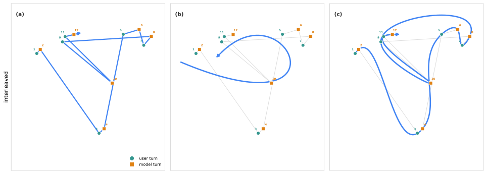
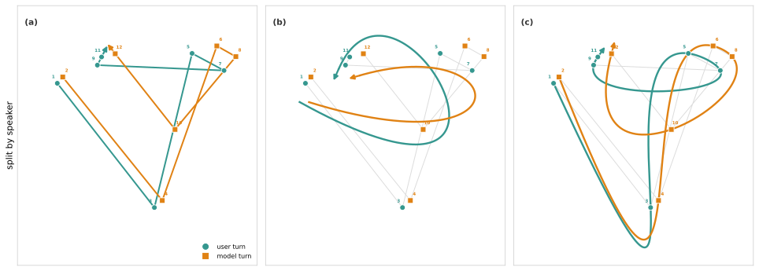
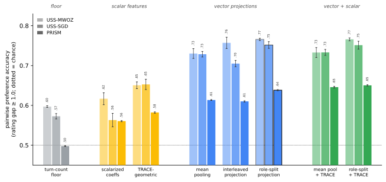
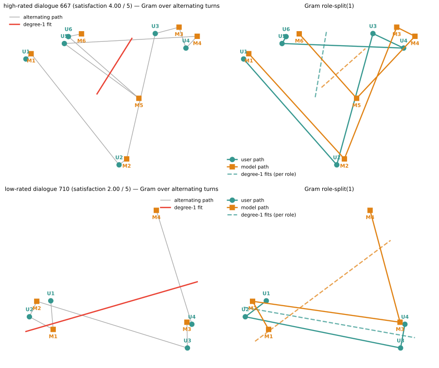
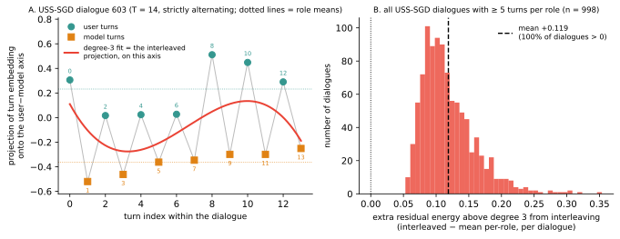
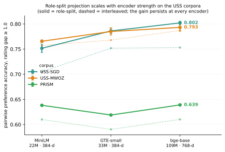
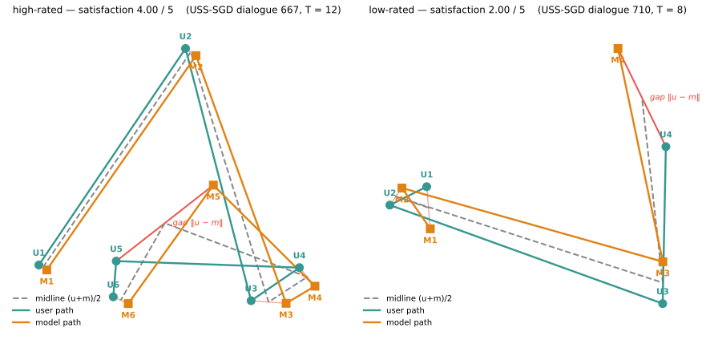
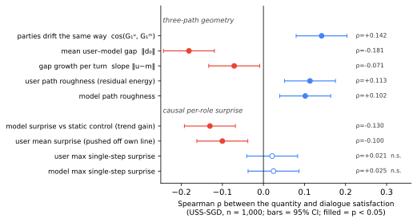
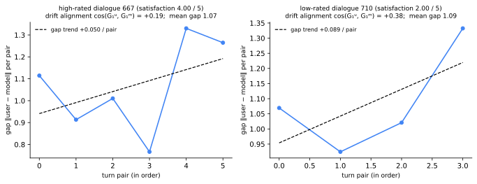
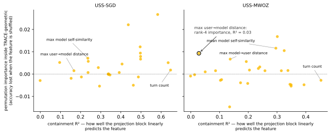

<!-- src: tags name the producing script; regenerate with `python main.py`; artifact at data/results/trace_h2h/<script-stem>.json, provenance in its _provenance block. Invisible when rendered. -->
# Analysis of Conversation Trajectory Representations: Orthogonal Projections versus Scalar Geometry for Satisfaction Prediction

```{=latex}
\noindent{\small\textbf{Jacob Sussmilch}}\\[1pt]{\footnotesize Heya Enterprises Pty Ltd}\vspace{0.4em}
```

A conversation can be represented as a trajectory through high-dimensional semantic space — one point per turn — and a common way to use it is to summarize that trajectory as a fixed-size vector for a simple learner; which summary to use is the question this paper studies. We compare hand-crafted conversational geometry — scalar features of the trajectory, most prominently in TRACE (Gooding and Grefenstette, 2025) — against projecting the trajectory onto a low-order orthogonal-polynomial basis and keeping the coefficients, evaluating both on conversation-level user satisfaction. First, which representation wins is regime-dependent: the projection beats TRACE's geometric features by 5-12 points on all three corpora, but on short, first-person-rated chats the trajectory-shape channels collapse and hand-crafted scalars become a genuine complement — a difference of corpus and label construct, not of conversation length. Second, the projection's structure matters: read as one interleaved sequence, the projection blends the two speakers into shared low-degree coefficients. We therefore split the trajectory by speaker, giving the learner each speaker's content on its own path, and recommend that representation: training-free, and never distinguishably worse than any measured alternative in either regime. What the split buys is the content separation; the speaker-alternation aliasing it also removes is a representation-fidelity fact, not the source of the accuracy. This is offline preference prediction, not reward modeling: the content-based representations that predict satisfaction best are, plausibly, more optimization-gameable, so the ranking need not hold, and may invert, as a reward signal.

---

## 1. Intuition

The idea is easier to see than to state. Embed each turn of a conversation and it becomes a single point in semantic space; read the turns in order and the conversation becomes a path through that space (Figure 1, a-c). The path is jagged, because consecutive turns come from different speakers, but underneath the jaggedness is an overall shape — where the conversation starts, which way it drifts, how it bends — and that shape is what a geometric representation is trying to capture. Panel (a) is the raw interleaved path of one dialogue; (b) is a smooth low-order polynomial fit through it; (c) is a spline. Each asks the same question a different way: setting aside the turn-to-turn jitter, what is the trajectory of this conversation as a whole?


<!-- src: actr_figures.py -->

Figure 1: one USS-SGD dialogue in semantic space, shown as a 2-D PCA view of its turn embeddings (user turns teal circles, model turns orange squares, numbered in order), traced as a single interleaved path: (a) the raw path through every turn, (b) a degree-3 polynomial shape fit to it, (c) a spline through the turns. The path zigzags because consecutive turns come from different speakers.


<!-- src: actr_figures.py -->

Figure 2: the same dialogue split by speaker, each participant's turns forming their own path: (a) the two raw paths, (b) their degree-3 shapes, (c) their splines. Splitting by speaker removes the speaker-alternation zigzag so each individual shape can be read on its own.

Our central move is to change what "the trajectory" refers to. Instead of tracking one interleaved path and reading relationships off the complete sequence, we split the conversation by speaker and plot each participant's turns as their own path (Figure 2, a-c): the user's trajectory and the model's trajectory side by side, each with its own shape. Much of the interleaved zigzag is nothing but the two speakers alternating — a regular back-and-forth that a whole-conversation fit spends its low-order structure describing. Separate the speakers and that alternation is gone from each path; what remains is where each individual actually went, and the object of interest becomes the relationship between the two shapes rather than the shape of their interleaving.

With a role-split representation of the conversation as a trajectory through high-dimensional semantic space, we can now begin to analyze how each speaker leads or follows within a conversation, and how the conversational dynamics between the two speakers affect things like satisfaction.

---

## 2. Introduction

A growing line of work scores conversation quality from the geometry of how the dialogue moved: the path its turn embeddings trace through semantic space. The most prominent instance is TRACE (Gooding and Grefenstette, 2025, arXiv:2511.08394), which predicts conversation-level user satisfaction from roughly thirty hand-crafted scalar features — average and maximum self-similarity of model turns, drift from a stated goal, turn-to-turn volatility, trends in relevance — fed to a random forest, and reports that this geometric signal rivals an LLM judge on their corpus and combines with it additively.

Every feature in such a suite embodies the same unexamined design decision: it is a *scalarization* of an underlying vector object, almost always through a distance or a cosine. The trajectory itself — a sequence of points in $R^d$ — is reduced, feature by feature, to hand-picked one-dimensional summaries before any learning happens. The alternative this paper defends is older and simpler than feature engineering: fix an orthogonal basis, project the trajectory onto its first few elements, and hand the resulting *coefficient vectors* to the learner. Degree zero is exactly the mean embedding; degree one is the direction of net drift. No selection step, no pruning, a quantified residual, and no way to lose direction information you did not know you needed.

Scalarizing the trajectory and projecting it are the two options this paper weighs, within a small landscape of ways prior work has treated turn sequences plotted in a semantic space. Three poles dominate:

| pole | representation | instances | here |
|---|---|---|---|
| (a) hand-crafted trajectory geometry | scalar features of the path | TRACE (Gooding and Grefenstette, 2025); story shape — "speed/volume/circuitousness" (Toubia et al., 2021); creativity from semantic spread and path coherence (Hu et al., 2026) | the benchmark target |
| (b) learned aggregation | recurrent or attention encoders over turn vectors | Bodigutla et al. (2020); CRAFT (Chang and Danescu-Niculescu-Mizil, 2019) | untested (Section 8, item 11) |
| (c) fixed orthogonal basis projection | the trajectory's coefficient vectors | mean pooling is the degree-0 case; DCT coefficient vectors (Almarwani et al., 2019) | this paper's subject |

Outside NLP, projecting sampled trajectories onto an orthogonal basis and learning on the coefficients is the founding move of functional data analysis (Ramsay and Silverman, 2005), so the pole-(c) novelty claim is scoped to conversation turn-embedding trajectories. We benchmark (a) against (c).

TRACE is our benchmark target within pole (a). The headline behind that gloss — geometry rivaling a judge — is 68.20% pairwise preference accuracy versus 70.04% for an LLM judge (n.s.), and 80.17% for the hybrid, from the ~30 scalar features plus timing run through a random forest. Two clarifications matter for a fair comparison: their |r|>0.7 correlation pruning occurs in the interaction-screening stage of their analysis, not the reward model; and their corpus (~2,100 conversations, average 8.7 turns, first-person ratings) was never released, so ours is the first public-data evaluation of the feature suite. A methodological warning from the reasoning-trace literature transfers to every pole: raw trajectory geometry is confounded by sequence length (Gjølbye et al., 2026), which we answer structurally — a turn-count floor anchoring every scoreboard, and a length deconfound for the one regime reversal (Section 6.5).

For labels we draw on two public sources that span the regime axis. USS (Sun et al., 2021) provides 5-point satisfaction labels from three or more third-party annotators over dialogues from public task-oriented corpora including SGD (Rastogi et al., 2020) and MultiWOZ (Budzianowski et al., 2018); PRISM (Kirk et al., 2024) provides first-person ratings of real user-LLM conversations, with user IDs enabling grouped cross-validation; after the preprocessing filters of Section 5.1, 7,951 conversations from 1,395 users enter the evaluation.

On the projection side (pole (c)), mean pooling is the degree-0 special case of the representation studied here. DCT-based sentence and sequence encoders keep leading frequency coefficients as vectors (Almarwani et al., 2019); our basis study argues polynomials are the better-fitting prior for short aperiodic drifting sequences and *measures* the accuracy consequence — nil at matched truncation on all three corpora at the instrument's resolution, with one confirmed exception in the polynomials' favor on very short per-role sequences — so the preference for polynomials rests on per-coefficient interpretability everywhere, and on a measured accuracy margin exactly where per-role sequences are shortest (Section 6.6; Sussmilch, 2026). Gram (discrete orthogonal) polynomials underlie Savitzky-Golay filtering (Savitzky and Golay, 1964); truncation in an orthogonal basis gives the representation a natural anytime property.

Two gaps remain. First, outside the companion method paper (Sussmilch, 2026), no prior work keeps a full basis expansion of a conversation turn trajectory as vectors — pole (c) beyond its degree-0 mean-pooling special case. Second, no geometric-feature work states where its method stops applying: TRACE evaluates one proprietary corpus, and the story-shape and creativity lines each evaluate one domain, so none can observe a boundary. We evaluate two regimes and report the boundary itself as a result: the projection leads in both, but the marginal value of hand-crafted scalars reverses — inert on long task-oriented dialogue (USS), a genuine complement on short first-person chat (PRISM). The reversal is a corpus and label-construct effect rather than a length threshold, and an LLM-judge channel carries the same regime fingerprint.

### 2.1 Contributions

This paper makes six contributions:

1. The first public-data benchmark of TRACE-geometric — TRACE's 26 geometric features reimplemented and audited against its Appendix A inventory, evaluated on USS-SGD, USS-MWOZ, and PRISM (TRACE's corpus was never released).
2. The scalarization finding. Keeping projections as vectors dominates hand-crafted scalar geometry on long dialogues; four consecutive scalarization attempts lost, including scalarizations of our own winning coefficients; mean pooling alone beats the full 26-feature suite, which adds nothing on top of it on the USS corpora (Sections 6.1-6.2; the short-chat exception is contribution 5).
3. Role-split(1) as a training-free cross-regime default. One formula, no feature selection, no fitted encoder: project each speaker's turns separately and keep only degrees zero and one — a per-role mean plus a per-role drift vector (notation, Section 4.4). It beats the interleaved projection at matched capacity and at matched degree on SGD and PRISM (null on MWOZ), replicates across embedders with the gain *persisting* under the strongest encoder, and is never distinguishably worse than any measured arm in any regime — including the scalar-anchored combination that wins the short-chat regime (Sections 6.1, 6.3-6.5).
4. The role-information factorial. A role-blind reconstruction of TRACE's suite shows role information pays only in the projection class, where the gain localizes to the per-role means rather than to hand-crafted structure; the scalar suite's value survives role-blinding nearly intact (Section 6.4).
5. The regime boundary, mapped. On short first-person-rated chats the trajectory-shape channels collapse — a corpus and label-construct effect, not a length threshold — and content-anchored scalars become constructive; an LLM-judge channel shows the same fingerprint. No prior geometric-feature work states where its method stops applying; we treat the boundary as a first-class result (Sections 6.5, 6.7).
6. Causal per-role surprise, defined and validated descriptively. The role split makes per-role surprise well-defined: a prefix-only degree-1 extrapolation of each party's own path against a static-prediction control (Section 4.5). Used descriptively, it reproduces TRACE's two strongest qualitative findings — maximum model self-similarity as the most damaging signal, and the "coherently wrong" interaction — from projection geometry alone, composing into a single reading: satisfaction favors momentum without whiplash (Section 7). As predictive features these quantities add nothing over the vector blocks; their development is an open problem.

One further result is established along the way and treated as supporting rather than headline: basis invariance. Within the DC-plus-smooth class (Gram, DCT) the choice is measured free at the instrument's resolution — the one confirmed exception, on very short per-role sequences, favors the basis recommended here — and the role-split gain transfers across bases, so nothing above is basis-contingent (Sections 4.2, 6.6).

Framing guardrails. Everything here is *offline post-conversation user satisfaction prediction*: TRACE's title calls interaction dynamics "a reward signal," but its evidence, like ours, is offline preference prediction, no policy was optimized in either work, and we do not inherit the framing (Section 8, item 9). USS labels are third-party annotator judgments made from transcripts; PRISM labels are first-person; Section 6.5 shows the construct difference is empirically consequential.


<!-- src: actr_figures.py -->

Figure 3: the Table 1 core (all arms encoded with MiniLM; §6.3 carries the role-split projection's encoder-robustness, reaching 0.802 on USS-SGD under bge-base), grouped by representation class (grey floor, yellow scalar features, blue vector projections, green vector+scalar combinations; five-seed error bars throughout; each arm shows three corpus columns, light to dark: USS-MWOZ, USS-SGD, PRISM). One visual sentence: the projection group leads in both regimes, and the combination bars pull ahead of mean pooling only on PRISM — curated scalars are a short-first-person-chat phenomenon. The role-split projection (role-split(1)), outlined, is top-tier for all three corpora.

---

## 3. TRACE-geometric: a Public-Data Reimplementation

### 3.1 The feature suite and what we exclude

TRACE's Appendix A documents 30 features: 4 temporal (turn durations, gap-time median and MAD) and 26 geometric (repetition/inefficiency, semantic cohesion and relevance, goal orientation). The temporal four require event timestamps that no public corpus in our evaluation provides; we therefore evaluate the 26-feature geometric subset and write TRACE-geometric throughout. This exclusion is not free: gap-time features carried significant non-linear signal in TRACE's own analysis. On PRISM, where a crude duration-per-turn proxy is computable, its gain is +0.5 points, below the instrument's resolution (Table 1), but that does not license the conclusion that timing is dispensable on their corpus.

```{=latex}
\clearpage
```

### 3.2 Documented reconstruction decisions

TRACE leaves several implementation choices unspecified. Ours, fixed before evaluation and applied uniformly:

| Ambiguity | Our decision | Consequence |
|---|---|---|
| Embedding model (unspecified) | all-MiniLM-L6-v2, 384-d, L2-normalized | applies to all arms equally; robustness re-checked under GTE-small and bge-base |
| Goal embedding $G$ (no corpus carries a separately elicited goal) | $G$ = first user utterance, on all three corpora | two degeneracies, on every corpus: `goal_initial_prompt_dist` $\equiv 0$ (a constant column, leaving 25 informative features); `model_goal_dist_mean` $\equiv$ `model_initial_prompt_dist` (an exact r=1.0 pair in the measured correlation matrix) |
| $\text{Context}_{<i}$ in Semantic Cohesion (undefined) | mean of prior turn embeddings | — |
| Late-volatility window (unspecified) | last $\max(2, \lceil T/4 \rceil)$ steps | — |
| Regressor hyperparameters (unspecified) | `RandomForestRegressor`, 300 trees | matched across all arms |
| Rating coding (unstated) | native scales, pairwise protocol | pairwise preference is coding-invariant |
| LLM-judge prompt (their Appendix D Template 1 is prompt-optimized) | form-faithful minimal prompt (one-shot, transcript-only, integer 1-5); Template-1 sensitivity measured — all verdicts prompt-robust | Section 6.7 |

The goal-embedding proxy is the most consequential of these decisions and should be weighed first. Ten of the 26 features (all of Goal Orientation) are functions of a goal embedding $G$ that TRACE derives from each user's stated free-text goal, elicited independently of the transcript. No corpus in our evaluation carries such a field. PRISM's `opening_prompt` may look like one, but it is byte-identical to the first user turn in all 8,011 raw conversations: a denormalized copy of the transcript's opening, not an independently elicited goal<!-- src: goal_proxy_prism.py -->. We therefore set $G$ to the first user utterance uniformly, on all three corpora.

The substitution changes the *inputs* to the goal family, not their formulas, and it induces two degeneracies that are algebraic rather than corpus-specific: with $G$ equal to the first user turn, `goal_initial_prompt_dist` $\equiv 0$ identically, and `model_goal_dist_mean` $\equiv$ `model_initial_prompt_dist` identically. Both hold on every corpus, PRISM included, and we measure them there to float32 precision rather than assume them (constant column, max $|x| = 2.4 \times 10^{-7}$; the pair at $r = 1.0$ to thirteen decimals)<!-- src: goal_proxy_prism.py -->. One of the 26 features is thus a constant column throughout, and the r=1.0 pair makes a second redundant, leaving 24 linearly independent — a degeneracy that cannot flatter the suite: a constant column cannot carry signal, and the suite still loses.

Fidelity to TRACE's construct is what varies across corpora, and it varies in the direction opposite to what the field names suggest. On the USS corpora the opening turn genuinely *is* the task request ("I'd like to rent a car please"), so the proxy is a faithful stand-in for a goal that is satisfiable and whose satisfaction is what the labels track. On PRISM it is weakest: 61% of conversations are values- or controversy-guided<!-- src: goal_proxy_prism.py -->, and their openers ("is chivalry dead", "What is love?") name no satisfiable endpoint, so the Goal Orientation family there measures drift around a topic opener rather than progress toward a goal. The proxy is a strictly weaker operationalization of goal orientation than TRACE's on all three corpora, and every goal-feature result should be read in that light — most cautiously on PRISM, not least.

The embedding-model row deserves emphasis: TRACE's entire geometry is geometry *of an unspecified space* — every feature is a function of embeddings the paper never names — which is why the multi-embedder replication (Section 6.3) is a required robustness axis rather than an optional one.

---

## 4. Method: Orthogonal Trajectory Projection

The representation is the Gram polynomial projection developed in the companion method paper *Gram Projections for Conversation Trajectories: A Polynomial Equivalent of the DCT* (Sussmilch, 2026; "the companion" throughout), which carries the construction, the exact identities, and the basis comparison; we restate here only what this paper's arms and figures need and refer to it for the rest.

### 4.1 Representation

Let $e_1, \dots, e_T$ in $R^d$ be the L2-normalized turn embeddings of a conversation (all-MiniLM-L6-v2, $d = 384$; Wang et al., 2020; via sentence-transformers, Reimers and Gurevych, 2019) — deliberately the least engineered component of the pipeline: identical off-the-shelf embeddings feed every arm, TRACE-geometric included, so no result can be attributed to turn-representation quality (within-turn structure is scoped out in Appendix B.4). The degree-k Gram coefficient vectors $G_0, \dots, G_K$ ($K = \min(3, T-1)$) summarize the trajectory on the turn grid; by the companion's identities $G_0$ is *exactly* the mean (mean pooling as the degree-0 case) and $G_1$ the least-squares drift. The concatenation $[G_0 \mid G_1 \mid G_2 \mid G_3]$ (1,536-d) is the interleaved projection, this paper's whole-dialogue representation — always the full degree-3 block unless a truncation is stated; its truncated forms $[G_0 \mid G_1]$ (768-d) and $[G_0 \mid G_1 \mid G_2]$ (1,152-d) enter Section 6.3's degree-matched control.

### 4.2 Why projection

A basis expansion differs from a feature list in kind, on five axes:

| axis | hand-crafted scalar suite | basis projection |
|---|---|---|
| completeness | hand-picked one-dimensional summaries; omissions unknowable | complete to degree $K$, truncation residual quantified |
| ordering | none — a zoo has no natural order | canonical: degree = smoothness |
| direction | destroyed through distances and cosines (priced in Section 6.2) | preserved |
| selection step | feature design plus pruning | none — fixed linear functionals |
| subsumption | means and slopes are linear reparameterizations of the coefficients | inherits the mean/slope/endpoint family exactly |

The ordering row is why TRACE's suite required correlation screening in its analysis stage while the projection stays on top across corpora unscreened (Appendix B). Scoped exception: order statistics (max/min features) are not polynomial functionals, and Appendix B.3 shows grafting them onto the vector blocks adds nothing. The choice of Gram over the DCT (measured equivalent) or the DST (a priceable boundary) is the companion's subject; we adopt Gram for per-coefficient interpretability — a trend is a single $G_1$ (the per-role drift is the vector form of TRACE's "trend in model relevance"; Section 4.4), whereas no single DCT coefficient is a slope — and report the downstream consequence in Section 6.6.

### 4.3 Design arms

Three arms operationalize the featurize-versus-project axis, all consumed by the same regressor: the projected TRACE series (Gram degrees 0-3 of TRACE's own five scalar series; 20-d; the subsumption arm), scalarized coefficients (norms/angles of our vector coefficients; 9-d; our representation deliberately scalarized), and the interleaved projection (Section 4.1). Two ablations separate content from shape: mean pooling (384-d; identically $G_0$) and shape only (1,152-d; $G_1$-$G_3$) — the latter versus TRACE-geometric is the study's fairest shape-vs-shape contrast.

### 4.4 Role-split and the aliasing it removes

The interleaved sequence $u_1, m_1, u_2, m_2, \dots$ alternates between two regions of embedding space, the highest frequency the grid supports; a low-degree global polynomial cannot represent it, so it aliases into the low-degree coefficients — interleaved $G_1$ confounds "the conversation drifted" with "user and model occupy different regions" (Figure 4).

A caution before the reader over-reads this section: the aliasing is a representation-fidelity fact — the interleaved projection provably misdescribes the trajectory — but it is not, on its own, why the split predicts better. The accuracy the split buys comes from handing the regressor each speaker's content separately, which the degree ablation localizes to the per-role means (Section 6.4); removing the aliasing is necessary rather than sufficient, and pays only where the labels use what the alternation obscures — nil on MWOZ (Section 6.3).


<!-- src: actr_figures.py -->

Figure 4: two encodings of the same dialogues — the highest- and lowest-rated strictly-alternating USS-SGD dialogues at T <= 12. Left: the alternating turn sequence with its degree-1 fit, a line that belongs to neither speaker. Right: role-split(1), each role's path with its own mean-plus-drift fit.

Role-split removes the artifact by construction: project each speaker's subsequence on its own grid and concatenate the per-role blocks. Notation: role-split(K) keeps per-role degrees 0..K; role-split(1) (per-role mean plus drift, 1,536-d) is the recommended configuration, and unqualified role-split means the Gram basis. The construction and the exact midline/offset recovery ($c_k = (G_k^u + G_k^m)/2$, $d_k = G_k^u - G_k^m$) are the companion's (its Section 2.3). One tie to the thesis: the per-role drift $d_1$ is the vector form of TRACE's "Trend in Model Relevance," recovered as a linear combination of blocks rather than a hand-crafted scalar; what the split buys downstream is Figure 5 and Section 6.3.


<!-- src: actr_figures.py -->

Figure 5: the mechanism, measured. Panel A: one dialogue's turns projected onto the user−model axis form a square wave over the turn index — the highest frequency the grid supports — which the degree-3 fit (what the interleaved projection represents along this axis) cannot follow, absorbing it as a spurious low-degree trend. Panel B: the interleaved path leaves more residual energy above degree 3 than the per-role paths in 100% of the 998 USS-SGD dialogues with at least five turns per role (mean excess +0.119). Scope: exact for alternating dialogues; the argument holds qualitatively with consecutive same-role turns; speakers assumed binary.

### 4.5 Causal per-role surprise

The role split makes per-role surprise well-defined:

- $\text{pred}_j$ = degree-1 extrapolation of the party's own path, fit on its prefix only
- $\text{surprise}_j = 1 - \cos(\text{pred}_j, \text{actual}_j)$
- $\text{naive}_j$ = the same with a static (constant-position) one-step prediction
- $\text{trend\_gain} = \operatorname{mean}(\text{surprise}) - \operatorname{mean}(\text{naive})$

The prefix-only fit makes the quantity causal; an interleaved-sequence surprisal variant is excluded because its reference process is contaminated by exactly the Section 4.4 artifact. Section 7 reports what these quantities describe; like every derived scalar here, they add no predictive signal over the vector blocks.

---

```{=latex}
\clearpage
```

## 5. Experimental Setup

### 5.1 Datasets and labels

| Corpus | Conversations | Turns | Label construct | CV |
|---|---|---|---|---|
| USS-SGD | 1,000 | 25,666 (mean 25.7) | 5-point satisfaction, mean over 3+ third-party annotators | 5-fold by dialogue |
| USS-MWOZ | 1,000 | 22,108 (mean 22.1) | same | 5-fold by dialogue |
| PRISM | 7,951 (1,395 users) | 54,212 (mean 6.8) | first-person helpfulness, rescaled 1-5 | `GroupKFold(5)` by user |
<!-- src: actr_tables.py -->

The PRISM count reflects two preprocessing filters: conversations without a helpfulness score or with fewer than two turns are dropped. USS labels are third-party judgments made *from transcript text*, which plausibly inflates the content channel; PRISM labels are first-person but singular, so its annotator ceiling is unknowable. The USS ceiling is measured: leave-one-annotator-out agreement reaches 0.943/0.948 (gap 0.5) and 0.990/0.992 (gap 1.0) <!-- src: annotator_ceiling.py --> — at the primary gap the best arms operate at 76-84% of attainable agreement, and label noise does not explain absolute accuracy levels.

### 5.2 Protocol and inference calibration

All arms use an identical pipeline: `RandomForestRegressor` (300 trees, min_samples_leaf 2; Breiman, 2001) on the arm's representation, 5-fold out-of-fold predictions (user-grouped on PRISM), pairwise preference accuracy over conversation pairs with mean-rating gap >= 0.5 (secondary) or 1.0 (primary; SGD 44,052 pairs, MWOZ 33,334<!-- src: trace_h2h.py -->). Multi-seed replication runs five seeds; inferential contrasts use seed-ensembled predictions (the mean of per-seed OOF vectors) with m-out-of-n dialogue-resampling bootstrap CIs. One cross-paper caution: tables here print per-seed mean accuracies, while the companion's tables print seed-ensembled accuracies, which run about a point higher — the same runs under two printing conventions, not a discrepancy.

The instrument's resolution is measured, not assumed: median bootstrap CI half-width is ±2.3-2.6 points seed-ensembled (±2.6-3.3 single-seed)<!-- src: basis_calibration.py -->. Consequences, applied throughout: equivalence statements are estimation-framed (point difference with CI, decidable at a ±2.5-point band, never tighter); single-seed p-values at 1-3-point effects are treated as seed luck in either direction (we observed both). Superiority families receive Holm correction within family; p-values compare an arm to TRACE-geometric on the same corpus and gap unless stated otherwise. Three decision words carry these conventions through the prose: a contrast is *decided* when its 95% CI excludes zero (Holm-corrected where a family is declared), *null* when its CI spans zero at the instrument's resolution, and a *trend* when its point estimate is consistent but undecided. The tables carry the numbers; the prose uses the words.

```{=latex}
\clearpage
```

### 5.3 Floors and controls

Two trivial-feature floors (turn count alone; turn and token counts) and a TRACE-minus-counts ablation follow TRACE's own trivial-feature control. The dimensionality-matched control asks whether the projection's advantage is informational or mere capacity — every arm compressed per fold to the suite's own 26 dimensions, then scored against it:

| 26-dim control − TRACE-geometric | corpus | gap 0.5 | gap 1.0 (primary) |
|---|---|---|---|
| role-split → PCA-26 | USS-SGD | +4.1 [+0.2, +8.2], p=0.042 | +6.4 [+0.4, +13.0], p=0.040 |
| role-split → PCA-26 | USS-MWOZ | +4.6 [+0.8, +9.0], p=0.028 | +6.6 [-0.4, +13.3], p=0.062 |
| interleaved → PCA-26 | USS-SGD | +2.8 [-1.5, +7.0], p=0.138 | +3.7 [-2.4, +9.8], p=0.212 |
| interleaved → PCA-26 | USS-MWOZ | +2.8 [-1.2, +7.0], p=0.188 | +0.9 [-5.0, +7.4], p=0.776 |
| random projection-26 | USS-SGD | -7.9 [-12.6, -2.8], p<0.001 | -13.8 [-21.3, -6.0], p<0.001 |
| random projection-26 | USS-MWOZ | -5.7 [-10.0, -1.1], p=0.024 | -9.2 [-16.0, -2.2], p=0.016 |
<!-- src: actr_tables.py -->

::: tablenote
Note: single seed (42), 5-fold OOF, dialogue-resampling bootstrap CIs; PCA and the Gaussian random projection are fit per fold on training data only, and the TRACE-geometric baseline is recomputed under the same protocol, so its accuracies differ slightly from Table 1's five-seed means. <!-- src: dims_control.py -->
:::

Compressed to the suite's own dimensionality, the role-split projection still beats it (the MWOZ primary-gap cell is a trend); the interleaved block compressed the same way sits between, indistinguishable from the suite; and a random 26-dim projection is significantly worse — the advantage is informational, not capacity<!-- src: dims_control.py -->. The capacity-honest contrasts by construction — scalarized coefficients, and shape-only vs TRACE-geometric — are foregrounded in Section 6.2.

---

## 6. Results

### 6.1 The scoreboard

Table 1. Pairwise preference accuracy, gap >= 1.0, all three corpora.

| Variant                              | dims  | USS-SGD           | USS-MWOZ          | PRISM             |
| ------------------------------------ | ----- | ----------------- | ----------------- | ----------------- |
| turn-count floor                     | 1     | 0.573 ± 0.007     | 0.597 ± 0.002     | 0.498 ± 0.001     |
| TRACE-geometric                      | 26    | 0.653 ± 0.013     | 0.651 ± 0.009     | 0.582 ± 0.002     |
| projected TRACE series               | 20    | 0.666 ± 0.017     | 0.601 ± 0.013     | 0.564 ± 0.001     |
| scalarized coefficients              | 9     | 0.563 ± 0.017     | 0.617 ± 0.015     | 0.560 ± 0.001     |
| pooled scalars (all scalar variants) | 55    | 0.658 ± 0.012     | 0.667 ± 0.010     | 0.581 ± 0.002     |
| mean pooling ($G_0$)                 | 384   | 0.729 ± 0.007     | 0.730 ± 0.012     | 0.614 ± 0.001     |
| shape only ($G_1$-$G_3$)             | 1,152 | 0.690 ± 0.011     | 0.712 ± 0.010     | 0.523 ± 0.003     |
| interleaved projection ($G_0$-$G_3$) | 1,536 | 0.705 ± 0.008     | 0.757 ± 0.014     | 0.610 ± 0.002     |
| role-split(1)                        | 1,536 | **0.752 ± 0.008** | **0.766 ± 0.003** | 0.638 ± 0.001     |
| mean pooling + TRACE                 | 410   | 0.733 ± 0.007     | 0.733 ± 0.013     | 0.646 ± 0.002     |
| role-split(1) + TRACE                | 1,562 | 0.751 ± 0.010     | **0.766 ± 0.004** | **0.650 ± 0.002** |
| mean pooling + TRACE + duration/turn | 411   | —                 | —                 | **0.650 ± 0.002** |
<!-- src: actr_tables.py -->

::: tablenote
Note: Cells give the mean pairwise-preference accuracy across five seeds, ± one standard deviation. "TRACE-geometric" is the 26-feature reimplementation of TRACE; "the combo" is mean pooling concatenated with TRACE; "the graft" is role-split(1) concatenated with TRACE. The duration/turn proxy is available only on PRISM, since the public USS corpora carry no timestamps. Differences and CIs quoted in the text are seed-ensembled (Section 5.2), so they can deviate slightly from subtraction of the printed cell means. Bold marks the best score in each corpus column, ties at printed precision sharing it — a maximum marker, not a significance statement.
:::

Six statements carry the inference, each Holm-corrected within its family.

1. Projection beats featurization on long dialogues: the interleaved projection beats TRACE-geometric on MWOZ — decided — and the SGD margin, a MiniLM trend, resolves to decided under both stronger embedders<!-- src: multimodel_eval.py -->.
2. The corrected suite never reaches mean pooling on any corpus.
3. Role-split(1) beats its own interleaved form at matched capacity — seed-robust on SGD and PRISM, null on MWOZ, under all three embedders (Table 2) — and at matched degree, where the same fingerprint reproduces against the interleaved projection truncated to $[G_0 \mid G_1]$ (Section 6.3)<!-- src: interleaved_degree.py -->.
4. Scalars are constructive only on PRISM: the combo clears mean pooling there — decided — and is inert on both USS corpora.
5. Role-split(1) is indistinguishable from the PRISM-winning combo head-to-head and ahead of it on both USS corpora — never distinguishably worse anywhere, the only feature-free arm with that property (the never-worse ledger, Section 6.5).
6. The graft (role-split(1) + TRACE) ties the duration-augmented combo for the best PRISM estimate but does not survive correction and is inert on USS — an optional, never-harmful extension<!-- src: rolesplit_graft.py -->.

### 6.2 Scalarization: four consecutive losses

Every attempt to summarize vector structure into scalars lost.

| # | Scalarization | Verdict |
|-|------------|------------------|
| 1 | TRACE-geometric (26 scalars) | below mean pooling on both USS corpora; 5-12 points below the role-split projection everywhere (Table 1) |
| 2 | scalarized coefficients — norms/angles of our own winning coefficients | 0.563 ± 0.017 on SGD: *worse than TRACE*, p=0.002 — direction, not magnitude, carries the signal |
| 3 | Coupling scalars ($\cos(G_1^u, G_1^m)$, lag correlation, drift-to-goal angles) grafted onto the interleaved block | no marginal value, p=0.41-0.73; alone 0.55-0.56 |
| 4 | Recurrence (RQA) and similarity-spectrum statistics | RQA significantly *negative* on MWOZ (p=0.002/0.026); spectrum effective rank = `n_turns` in disguise (r=0.879/0.915), killed by the confound rule |
<!-- src: actr_tables.py -->

The mechanism: scalarization almost always passes through a distance or angle, which destroys the direction of the underlying vectors; Appendix B.3 measures the containment — the mean/slope family is substantially recoverable from the vector block (the reverse is dimensionally impossible), while the order statistics are not recoverable and still add nothing when grafted on. A capacity control separates direction loss from dimensionality: keeping just nine PCA dimensions of the same coefficient block recovers +7.9 points over the nine scalarized coefficients on both USS corpora — decided on both — and is statistically indistinguishable from the full 26-feature suite — at matched capacity, it is the scalarization that loses the signal<!-- src: capacity_uniqueness.py -->.

### 6.3 Role-split: the gain survives matching and encoder strength

The multi-seed test compared role-split(3) (3,072-d) against the interleaved projection (1,536-d) and found no Holm-robust gain <!-- src: multiseed_probes.py --> — a comparison that confounds a 2:1 capacity mismatch in the split's favor with two noise-carrying degrees per role working against it. The matched-dimensionality follow-up isolates the question at 1,536-d each; Table 2 reports it across all three embedders. The split wins on SGD and PRISM and is null on MWOZ under every encoder, and the degree ablation shows K=1 matches or exceeds K=3 on every corpus — the K=3 block diluted a real low-degree signal<!-- src: eqdim_probes.py, degree_ablation.py -->. Two further measurements complete the picture. Under a linear head (single-seed) the split is the strongest arm on both USS corpora and stays ahead of its interleaved form on PRISM, where the scalar-anchored combination leads and mean pooling edges past the split, both margins within the single-seed resolution — consistent with the regime boundary of Section 6.5. And the projection class transfers to a second task: on SGD service classification role-split(3) reaches 0.825 and the interleaved projection 0.846, against TRACE's 0.452 — evidence that the class carries task-general signal, not that the split helps on that task<!-- src: service_transfer.py -->.

Table 2. Role-split(1) vs the interleaved projection, all three embedders.

| corpus   | embedder | interleaved   | role-split(1)     | Δ (95% CI, p)                   |
|---|---|---|---|---|
| USS-SGD  | MiniLM   | 0.705 ± 0.008 | 0.752 ± 0.008     | +4.7 [+0.4, +7.0], p_holm=0.048 |
| USS-SGD  | GTE      | 0.752 ± 0.012 | 0.786 ± 0.005     | +3.3 [+0.2, +6.5], p_holm=0.030 |
| USS-SGD  | bge      | 0.753 ± 0.007 | **0.802 ± 0.003** | +4.7 [+1.5, +8.0], p_holm<0.001 |
| USS-MWOZ | MiniLM   | 0.757 ± 0.014 | 0.766 ± 0.003     | +0.9, n.s.                      |
| USS-MWOZ | GTE      | 0.768 ± 0.004 | 0.785 ± 0.007     | +1.5, n.s.                      |
| USS-MWOZ | bge      | 0.787 ± 0.003 | **0.793 ± 0.008** | +0.4, n.s.                      |
| PRISM    | MiniLM   | 0.610 ± 0.002 | 0.638 ± 0.001     | +2.8 [+0.4, +5.4], p=0.018      |
| PRISM    | GTE      | 0.590 ± 0.002 | 0.619 ± 0.000     | +2.9 [+0.5, +5.1], p=0.022      |
| PRISM    | bge      | 0.610 ± 0.001 | **0.639 ± 0.002** | +2.9 [+0.6, +5.0], p=0.014      |
<!-- src: actr_tables.py -->

::: tablenote
Note: All results are at rating-gap >= 1.0. Cells give the mean accuracy across seeds (five for MiniLM, three for GTE and bge), ± one standard deviation; the significance contrasts and printed Δ are seed-ensembled (Section 5.2). The embedders are GTE-small (Li et al., 2023) and bge-base-en-v1.5 (Xiao et al., 2024). Bold marks the best accuracy per corpus, across embedders and both arms. <!-- src: eqdim_probes.py, rolesplit_embedders.py -->
:::

The fingerprint (SGD strong, PRISM present, MWOZ null) reproduces under all three embedders (Figure 6), the PRISM gain significant under each. This kills the rival reading that a stronger embedder makes role-splitting unnecessary: the opposite holds — the gain persists undiminished under the strongest encoder, where bge role-split(1) is the study's highest judge-free accuracy (Table 2).


<!-- src: actr_figures.py -->

Figure 6: Table 2 as a picture — the role-split projection (solid) and its capacity-matched interleaved control (dashed) across encoders, colored by corpus. The gain persists at every encoder (0.802 on USS-SGD under bge-base) while PRISM stays flat. GTE and bge-base are a robustness check on the decisive arm; the full scoreboard under them remains single-seed per cell (Section 8, item 4).

Matched dimensionality leaves one confound standing: at 1,536-d each, role-split(1) carries per-role degrees 0-1 while the interleaved arm carries degrees 0-3, and the degree ablation's own finding — higher degrees dilute — makes “drop the noisy degrees” a live rival reading of Table 2. The completing cells close it — a further follow-up, decision rules fixed before execution: the interleaved projection truncated to $[G_0 \mid G_1]$ (768-d) and to $[G_0 \mid G_1 \mid G_2]$ (1,152-d), MiniLM, standard five-seed protocol — with one column per rival reading:

| corpus | role-split(1) − $[G_0 \mid G_1]$ (95% CI, p) | truncation: $[G_0 \mid G_1]$ − full block | drift: $[G_0 \mid G_1]$ − mean pooling |
|---|---|---|---|
| USS-SGD | +3.3 [+1.3, +5.6], p_holm=0.012 | +1.2, n.s. | -1.3, n.s. |
| USS-MWOZ | +1.7 [-0.5, +3.9], n.s. | -1.6, n.s. | +1.8, n.s. |
| PRISM | +3.6 [+1.9, +5.2], p_holm<0.001 | -0.8, n.s. | -0.9, n.s. |
<!-- src: actr_tables.py -->

::: tablenote
Note: rating-gap >= 1.0, MiniLM, five seeds, seed-ensembled contrasts (Section 5.2). The first column is Holm-corrected within its three-corpus family; the truncation and drift columns are uncorrected, every cell null. <!-- src: interleaved_degree.py -->
:::

Three readings, one per column. Degree-matched, the fingerprint reproduces: the split's gain is not a truncation artifact. Truncation itself buys the interleaved family nothing distinguishable. And the interleaved drift block adds nothing over the interleaved mean — the aliased copy of the role separation that Section 4.4 locates in interleaved $G_1$ carries no usable signal until it is split. The factorial now bounds both confounds — degree, by the truncation column; capacity, by the multi-seed role-split(3) arm, which held the same 2:1 advantage at matched degree and produced no Holm-robust gain — and what survives both matchings is the split. One adjacent contrast, previously quoted only descriptively, also resolves: role-split(1) beats mean pooling on PRISM — decided (the never-worse ledger, Section 6.5) — while the SGD margin stays within the instrument's resolution (the matching table above).<!-- src: interleaved_degree.py -->

The matching choice is itself a sensitivity axis, and SGD is the one corpus where the margin moves with it:

| matching | interleaved arm | Δ, role-split(1) − interleaved (95% CI, p) |
|---|---|---|
| capacity-matched (Table 2) | $[G_0 \mid G_1 \mid G_2 \mid G_3]$, 1,536-d | +4.7 [+0.4, +7.0], p_holm=0.048 |
| degree-matched | $[G_0 \mid G_1]$, 768-d | +3.3 [+1.3, +5.6], p_holm=0.012 |
| best post-hoc configuration | $G_0$ (mean pooling), 384-d | +2.1 [-0.8, +5.2], p=0.154 |
<!-- src: actr_tables.py -->

::: tablenote
Note: USS-SGD at rating-gap >= 1.0, MiniLM, seed-ensembled predictions (Section 5.2); each row re-matches the same role-split(1) arm against a different interleaved configuration. The first two rows carry Holm-corrected p within their pre-fixed families; the last row's comparison arm is chosen post hoc as the interleaved family's best of four configurations on this corpus, so its uncorrected p is not comparable to the corrected rows above it. <!-- src: eqdim_probes.py, interleaved_degree.py -->
:::

The reading: the split is decided against any fixed interleaved configuration and undecided only against the post-hoc best of the four, the mean — a deliberately conservative bound, since the post-hoc selection biases the baseline upward, and a restatement of Section 6.4's localization of the gain to the per-role means rather than a new fragility. The sensitivity is SGD's alone: PRISM decides for the split under all three matchings (+2.8, +3.6, and +2.7 against its post-hoc best, p=0.020), USS-MWOZ under none.

As Section 4.4 cautioned, the aliasing mechanism is necessary rather than sufficient: removing it buys accuracy only where the labels use what alternation obscures, and the MWOZ null, stable across all three embedders, bounds its predictive reach.

### 6.4 The role-information factorial: it localizes to the per-role means

The role-blind control (per-feature audit committed alongside the artifact) completes the {featurize, project} x {role-aware, role-blind} factorial. Nineteen of TRACE's 26 features admit role-blind analogues — the same functional form over the undifferentiated turn sequence; the seven that do not are exactly the cross-role relevance family, where the pairing *is* the construct. The goal anchor is role-blind by corpus accident (100% of dialogues open with a user turn), and role-blinding collapses five of the nineteen columns into duplicates or constants — the suite is built on distinctions that do not survive the operation.

Table 3. The marginal value of role information, by representation class.

| representation class           | role-blind                          | role-aware                          | role information is worth                |
|---|---|---|---|
| projection (1,536-d)           | interleaved projection, 0.610       | role-split(1), **0.638**            | +2.8, p=0.018 (embedder-robust, Table 2) |
| scalar suite (on mean pooling) | mean pooling + role-blind 19, 0.639 | mean pooling + role-aware 19, 0.639 | -0.1, p_holm=0.83                        |
<!-- src: actr_tables.py -->

::: tablenote
Note: Measured on PRISM at rating-gap >= 1.0, using seed-ensembled predictions. Bold marks the larger score of each role-blind/role-aware pair; the scalar pair prints equal, so neither is bold. <!-- src: roleblind_probes.py, eqdim_probes.py -->
:::

The full 26-feature combo adds under a point over its role-aware 19-feature subset (CI spans zero) — the unconfirmed worth of the inherently cross-role seven. The interaction is the finding (Table 3): role information pays only in the projection class, and there the gain localizes to the per-role means — the degree ablation places it in role-split's degree-0 block, with the per-role shape degrees adding nothing distinguishable (K0-vs-K3 p=0.54 on PRISM, 0.82 on SGD)<!-- src: degree_ablation.py -->. MWOZ is why the recommendation keeps the drift block nonetheless: there the per-role means alone fall to 0.728 against role-split(1)'s 0.770 in the same ablation (the tested K0-vs-K3 contrast is undecided at the instrument's resolution, CI [-7.9, +1.7]) — dropping to role-split(0) is never measured better anywhere and carries the one large downside point estimate, so role-split(1) is the smallest configuration with the never-worse property<!-- src: degree_ablation.py -->. Splitting thus buys a per-role content separation the interleaved mean discards — which is why the gain persists on PRISM, where trajectory shape collapses (Section 6.5) — not the hand-crafted structure of a feature suite. TRACE's per-role feature engineering buys no confirmed accuracy on these corpora.

One alternative explanation required a direct test. PRISM spans 21 models, and the per-role model mean is close to a model-identity fingerprint: a multinomial probe recovers the model from $G_0^m$ alone at 34.8% accuracy against an 8.9% majority baseline, so the confound is mechanically available to the regressor, and model identity explains 3.0% of rating variance, so it has a channel to the label. It is not the source of the gain (the never-worse ledger, Section 6.5). Restricting evaluation to same-model conversation pairs retains the point estimate (+2.4 of the +2.8; the restricted slice is underpowered at the primary gap). The decisive test adds a model-identity one-hot to both arms and re-scores under the standard protocol (five seeds, seed-ensembled; Section 5.2): role-split(1)+ID beats interleaved+ID — decided, at 92% of the original margin. Handing the interleaved arm the model's identity for free does not close the gap; the per-role mean separation carries content beyond identity<!-- src: identity_probes_prism.py, identity_controls_prism.py, identity_augment_prism.py -->.
<!-- src: roleblind_probes.py -->

### 6.5 The regime boundary: trajectory shape collapses on short first-person chats

Mean pooling dominates USS: it beats every scalar arm (Table 1), and concatenating all 26 scalars onto it moves nothing<!-- src: g0_combo.py -->. The marginal shape contribution (interleaved projection minus mean pooling, five-seed) is positive only on MWOZ — +2.7 points there, negative on SGD, nil on PRISM <!-- src: multiseed_probes.py --> — a fact that Section 6.6's DST mechanism converts into a measured prior. TRACE's deliberate content-exclusion costs it 3-8 points against mean pooling even after correction (Table 1).

On PRISM everything reverses (Table 1, right column; Figure 3): the turn-count floor collapses to chance and anti-predicts within users; pure shape collapses; the scalars become constructive with content. The deconfound rules out the tempting attribution — length is not the driver:

| slice | shape only ($G_1$-$G_3$) | TRACE-geometric | combo − mean pooling |
|---|---|---|---|
| PRISM, short bin (<= 6 turns) | 0.545 | 0.571 | +2.7 [+0.9, +4.5], p=0.002 |
| PRISM, long bin (7-44 turns) | 0.511 | 0.587 | +3.1 [+1.3, +4.9], p=0.002 |
| USS-SGD, truncated to 7 turns | 0.569 | 0.490 | +0.5, n.s. |
| USS-MWOZ, truncated to 7 turns | 0.464 | 0.535 | -1.8, n.s. |
<!-- src: actr_tables.py -->

::: tablenote
Note: rating-gap >= 1.0, MiniLM, single seed (the standard protocol at seed 42; Section 5.2). PRISM is median-split by turn count; the USS rows re-run the protocol on dialogues truncated to their first seven turns, PRISM's mean length. If length drove the regime, shape would recover in PRISM's long bin and the scalar channel would turn constructive on truncated USS; the columns show neither. <!-- src: deconfound_length.py -->
:::

Shape stays at chance in PRISM's own long bin, and truncating USS to PRISM's mean length does not reproduce the PRISM pattern — the scalar channel collapses rather than turning constructive, and the combo moves nothing on truncated USS while winning both PRISM bins<!-- src: deconfound_length.py -->. What remains bundled: label construct (first-person vs third-party) and conversation provenance (real user-LLM chat vs simulated task flows). Goal grounding is not a bundled difference — no corpus carries an elicited goal (Section 3.2); the goal proxy is simply least faithful on PRISM, so the scalars win on exactly the corpus where their Goal Orientation family is weakest, which if anything understates their short-chat value. Absolute accuracy also drops everywhere on PRISM (Table 1): first-person satisfaction is harder to predict from the transcript than third-party judgments *of* the transcript.

Among the arms measured, the recommendation across all three corpora is role-split(1): indistinguishable from the winning combination where scalars help, ahead of it where they do not, and never distinguishably worse than any measured arm in any regime. Whether the mean-pooling combination shares the never-worse property is undecided at the instrument's resolution on both USS corpora, in the split's favor on both (the ledger below); what is decided is the direction of risk — the combination is never measured distinguishably better than the split anywhere, and it buys its parity with a 26-feature suite the split does not need. Curated scalars are an optional graft on short first-person chats — never harmful, possibly worth a point, unconfirmed.

The never-worse ledger — role-split(1) against its closest rivals.

| contrast (Δ = first − second) | corpus / pair slice | Δ | 95% CI | p | reading |
|---|---|---|---|---|---|
| role-split(1) − combo | USS-SGD | +1.7 | [-1.0, +4.7] | 0.25 | undecided, split ahead |
| role-split(1) − combo | USS-MWOZ | +3.1 | [-1.0, +7.3] | 0.126 | undecided, split ahead |
| role-split(1) − combo | PRISM, head-to-head | -0.6 | [-2.8, +1.5] | 0.538 | indistinguishable |
| role-split(1) − mean pooling | PRISM | +2.7 | [+0.4, +4.9] | 0.02 | decided |
| role-split(1) − interleaved | PRISM, same-model pairs | +2.4 | [-0.3, +4.9] | 0.092 | undecided (underpowered slice) |
| role-split(1)+ID − interleaved+ID | PRISM | +2.6 | [+0.05, +4.8] | 0.05 | decided |
<!-- src: actr_tables.py -->

::: tablenote
Note: Δ in accuracy points at rating-gap >= 1.0, seed-ensembled; readings use the Section 5.2 decision vocabulary. The combo is mean pooling + TRACE (Table 1); +ID appends a model-identity one-hot to both arms (Section 6.4). <!-- src: capacity_uniqueness.py, uniqueness_mwoz.py, rolesplit_graft.py, interleaved_degree.py, identity_controls_prism.py, identity_augment_prism.py -->
:::

### 6.6 Basis invariance, measured

Within the DC-plus-smooth class basis choice is nearly free: Gram and DCT differ by at most 1.5 points anywhere, the one decided contrast — Gram over DCT for the role-split on PRISM, +1.5 points — favors the recommended basis and sits below the ±2.5-point band; the role-split gain reappears in the DCT basis with positive point estimates on all three corpora (decided Fisher-combined across the three; individually the MWOZ contrast is null there too, matching Section 6.3) — a property of the split, not the basis. The companion's length-stratified test passes its stated decision rule and localizes that one exception: the Gram-DCT gap concentrates in pairs at <= 2 turns per role (interaction +2.3 points, 95% CI [+0.3, +4.4], p = 0.022) and vanishes when both sides have three or more — mechanism-consistent with the length-stable scale of the Gram drift coefficient, and squarely PRISM's regime (median 3 turns per role). Our companion paper scopes it: the localization test ran on the corpus that generated the hypothesis, so a content or label confound is not excluded. Leaving the class costs only where shape is informative: DST loses ~3.5 points exactly and only on MWOZ, the one corpus with positive marginal shape contribution (mechanism, Section 4.2). The full basis study — Gram-DCT equivalence, the DST boundary, and the cross-length mechanism with its localization test — is developed in the companion method paper (Sussmilch, 2026); the recommendation of Section 6.5 is therefore not basis-contingent.

### 6.7 The judge channel: same regimes as the scalars

TRACE's strongest reported number is its geometry+judge hybrid (80.17%). We measure where the judge channel survives representation strength, using frozen one-shot integer ratings (claude-haiku-4-5; zero API calls in this cell)<!-- src: judge_stack.py -->.

Table 4. Judge stacking.

| Variant                                   | USS-SGD           | USS-MWOZ      | PRISM subset      |
| ----------------------------------------- | ----------------- | ------------- | ----------------- |
| MiniLM role-split(1)                      | 0.756 ± 0.003     | —             | —                 |
| MiniLM role-split(1) + judge              | **0.800 ± 0.011** | —             | —                 |
| MiniLM role-split(1) + judge (Template 1) | 0.780 ± 0.014     | —             | —                 |
| bge role-split(1)                         | 0.802 ± 0.003     | 0.793 ± 0.008 | 0.609 ± 0.002     |
| bge role-split(1) + judge                 | **0.818 ± 0.001** | 0.793 ± 0.010 | **0.661 ± 0.002** |
| bge role-split(1) + judge (Template 1)    | 0.807 ± 0.005     | 0.793 ± 0.010 | 0.639 ± 0.003     |
<!-- src: actr_tables.py -->

::: tablenote
Note: Cells give the mean over three seeds (42, 7, 123 — a subset of Table 1's five), ± one standard deviation, at rating-gap >= 1.0; the MiniLM judge-free baseline therefore differs slightly from its five-seed Table 1 mean. The PRISM figures use the 2,000-conversation subset that the judge rated, sampled uniformly without replacement under a fixed seed before any rating took place. Bold marks the best arm within each embedder block and corpus; the bge USS-MWOZ column prints identically across arms and carries no bold. <!-- src: judge_stack.py, judge_template1.py, llm_judge.py -->
:::

Four verdicts, all readable off Table 4. (i) On SGD the judge does not demonstrably stack on the strong encoder (undecided) and on MWOZ it is flat: the old hybrid's judge value was substantially encoder-compensation — it lifts MiniLM roughly three times as far as bge, and the judge-free bge split already sits where the MiniLM system needed a judge to reach. (ii) On PRISM the judge stacks strongly — decided — the same regime fingerprint as the scalars: absorbed by representation strength on long dialogue, additive on short first-person chats. (iii) The best arm, bge role-split(1) + judge, reaches 83.4% of the SGD annotator ceiling (Section 5.1) — the ratio is on the seed-ensembled accuracy (0.826), not the three-seed mean of 0.818 shown in Table 4. (iv) The verdicts are prompt-robust: re-rating all corpora with TRACE's own prompt-optimized Template 1 (same model, same frozen protocol)<!-- src: judge_template1.py -->, every verdict holds or strengthens — SGD stacking shrinks, MWOZ flat, PRISM attenuated (a decided attenuation). The prompt-optimized template underperforms the minimal one on both corpora where the judge channel carries signal — SGD, the regime closest to TRACE's, and PRISM — and ties it on MWOZ, where the channel is flat under either prompt; prompt engineering tuned on one corpus did not transfer, a datum for representation over prompt-engineering.

### 6.8 What scalarization is for

The four losses of Section 6.2 are a verdict about *predictive fidelity*, not about scalarization as such. A hand-crafted scalar suite is a bet on a prior — that satisfaction lives in content-agnostic interaction dynamics rather than in what was said — and the bet buys properties this benchmark does not reward. The first is interpretability: "maximum model self-similarity" names a failure mode a coefficient block cannot, which is precisely why the descriptive vocabulary of the next section is built from scalars rather than vectors. The second is compactness: a handful of features regularize where a 1,536-dimensional block can overfit — a benefit real enough that our own capacity control reproduces it with nine principal components of the coefficients (Section 6.2). The third, and the most consequential, is content-exclusion: a score computed without retaining the transcript is privacy-preserving, plausibly more transferable across topics, and — the asymmetry of Section 8 — harder to Goodhart than a content-based score, because a policy optimizing it has no high-scoring embedding region to chase. Our result is thus narrow by construction: keeping projections as vectors dominates hand-crafted scalars *at predicting satisfaction offline*, on these corpora, at this data scale. It adjudicates none of the other axes on which scalarization is actually chosen — diagnosis, sample efficiency, privacy, robustness under optimization — and on the last, our own winners are the weaker choice. The next section changes lanes accordingly: having shown that scalarization costs predictive accuracy, we adopt it where that cost does not apply, to *describe* the geometry of satisfaction.

---

```{=latex}
\clearpage
```

## 7. Descriptive Geometry of Satisfaction

This section is deliberately in a different lane from Section 6: vocabulary for *describing* conversations, with univariate effect sizes too small to add predictive value over the vector blocks — a distinction the coupling-scalar and surprise results make quantitative.


<!-- src: actr_figures.py -->

Figure 7: the three-path view (Section 4.4) on the Figure 4 exemplars: user and model paths, their midline, and the per-pair gap segments, the widest annotated. In the high-rated dialogue the model tracks the user turn-by-turn; the low-rated dialogue moves in large joint jumps. Exemplars illustrate the vocabulary; the corpus-level measurements are Figure 8.

The three-path view yields per-conversation geometric quantities, all linear in the per-role blocks; Figure 8 reports their corpus-level correlations with satisfaction, all small and consistently signed<!-- src: ledger_stats.py, role_surprise.py -->. The signs compose into one reading: parties drifting the same way is satisfying; a large or growing user-model gap is not; *rougher* paths correlate with *more* satisfaction; model momentum (beating a static prediction of its own path) reads as satisfying and a user forced off their own line as dissatisfied — while the single worst deviation carries no signal, only the average does (the hollow rows of Figure 8). Composed: satisfaction favors paths that move, but move predictably along their own direction — momentum without whiplash. Repetition is smooth *and* momentum-free, which is why both geometric families flag it from opposite directions; this reproduces TRACE's two strongest findings — maximum model self-similarity as the most damaging signal, and the "coherently wrong" interaction — descriptively, from projection geometry alone.


<!-- src: actr_figures.py -->

Figure 8: the section's vocabulary as measurements: Spearman correlations with satisfaction (USS-SGD, n=1,000; bars = 95% CI; filled = p<0.05), positive for co-drift and path roughness, negative for gap size, gap growth, and per-role surprise. The max-surprise rows are the built-in null contrast — the average deviation carries signal, the single worst step does not — and every effect is small, which is the section's point.

The honesty constraint that keeps this section descriptive: as predictive features the same quantities add nothing marginal over the vector blocks. Per-category profiles with FDR correction are included in the released artifacts. <!-- src: descriptive_profiles.py -->


<!-- src: actr_figures.py -->

Figure 9: the same vocabulary at exemplar grain — per-pair gap profiles with trends, drift alignment and mean gap in the titles — shown deliberately as a caution: this pair does *not* reproduce the corpus-level signs (the low-rated dialogue has the higher drift alignment and the steeper gap trend). Effects of |rho| = 0.07-0.18 are invisible in any single pair of dialogues, which is exactly why this section's evidence is Figure 8 and why exemplars stay descriptive.

---

## 8. Limitations

Two of the items below are declared scope decisions (9, 11); the rest are measured limitations of the evidence.

1. **TRACE-geometric is not TRACE.** Four of thirty features (all Temporal Dynamics) require timestamps public corpora lack, and gap-time features carried significant non-linear signal in TRACE's own analysis. The PRISM duration/turn proxy moved the combination by +0.5 points (Table 1), below the instrument's resolution, but a proxy is not their feature.
2. **Label constructs differ from TRACE's and from each other.** USS labels are third-party, made from transcripts — plausibly inflating the content channel; PRISM labels are first-person but singular, its ceiling unknowable. The measured USS ceiling (0.94-0.99) makes the efficiency claim precise: the best arms reach 76-84% of full-information attainable agreement from a fixed-size summary — a rate-distortion price; whether a learned summary at matched dimensionality closes part of the gap is future work.
3. **The regime boundary is corpus-attributed, not fully causal.** Length is ruled out<!-- src: deconfound_length.py -->; label construct, provenance, and goal grounding remain bundled; separating them needs a corpus crossing rater type with provenance, which our set does not contain. Model provenance in the narrow sense — which model generated each conversation — is ruled out for the role-split gain specifically (Section 6.4); provenance in the broad sense (real user-LLM chat versus simulated task flows) remains bundled — and frozen at each corpus's collection date, so the boundary could drift as assistants change.
4. **Embedding models and heads.** Primary results use MiniLM + RF. The headline effects and the recommended representation replicate under GTE-small and bge-base (3-seed, seed-ensembled); linear-probe replication landed; the full twelve-arm grid under alternate embedders remains single-seed per cell<!-- src: multimodel_eval.py -->; the degree-matched interleaved control (Section 6.3) is measured under MiniLM only<!-- src: interleaved_degree.py -->.
5. **Dimensionality is not matched in the headline comparison (1,536-d vectors vs 26 scalars).** The capacity-honest contrasts (scalarized coefficients; shape-only vs TRACE) and the PCA-26 control <!-- src: dims_control.py --> carry that burden.
6. **Inference resolution.** The bootstrap instrument resolves ~±2.5 points; effects below that are reported as estimates, and two single-seed p-values in this study's history moved across the significance line under seed-ensembling — in both directions. All inferential claims here are seed-ensembled.
7. **Goal-proxy degeneracies.** No corpus in our set carries an independently elicited goal — PRISM's opening prompt is a copy of the first user turn, not a separate field — so G = first user utterance throughout, merging two features and zeroing a third on all three corpora; a schema-description goal was not tested. The proxy's fidelity to TRACE's construct is weakest exactly where the scalars win: PRISM's goal-less openers (Section 3.2) mean its Goal Orientation family is the least faithful of the three, which we cannot separate from the other corpus differences bundled into the boundary. The same accident makes the goal anchor role-blind (Section 6.4).
8. **Subsumption is scoped.** Order statistics are not polynomial functionals; the subsumption argument covers the mean/slope/endpoint family only, and the order-statistic family carried ~5 points inside TRACE's own arm.
9. **Offline prediction only — and our winners are plausibly the more gameable ones.** Nothing here is a reward signal, and the asymmetry cuts against us where it matters most. The content-exclusion we price as pure cost on offline accuracy is a plausible *virtue* under optimization pressure: a reward built on content — mean pooling, or the projection coefficients — would be more directly Goodhart-hackable than TRACE's content-agnostic geometry, because a policy can chase the high-scoring embedding region head-on. So the offline ranking need not transfer to the reward-signal setting TRACE was built for, and may invert. Which trajectory channels can be *governed* into a Goodhart-resistant reward — and the per-role causal-surprise geometry (Section 7) that would underwrite them — is an open problem, not a claim made here.
10. **One judge family.** The judge channel is one model's frozen ratings; prompt sensitivity is now measured — every judge verdict holds under TRACE's own prompt-optimized Template 1 <!-- src: judge_template1.py --> — but the model axis (one judge family) remains single, and cross-paper judge numbers (their 80.17%) are never compared directly — different corpora, constructs, and ingredient lists.
11. **No learned-aggregation baseline.** Our comparison class is fixed representations; recurrent or attention encoders over the same turn embeddings (pole (b), Section 2) are untested. The recommendation of role-split(1) is a claim within the class of fixed representations measured — never distinguishably worse than any of them — not a claim about the best achievable representation; a frozen-embedding GRU probe is the natural referee and is left to future work.
12. One language. All three corpora are English, and so are all three embedders (MiniLM, GTE-small, bge-base-en); whether the projection-over-scalar ordering survives in other languages — where both the encoder and the conversational conventions change — is untested.

---

```{=latex}
\clearpage
```

## 9. Conclusion

We asked how a conversation trajectory should be represented for satisfaction prediction, and benchmarked the most prominent hand-crafted alternative — conversational geometry — on public data for the first time, corrected to the letter of its specification and documented where the specification ran out. Projecting the turn-embedding trajectory onto a low-order discrete-orthogonal basis — split by speaker — is never distinguishably worse than any measured alternative in any regime: it beats the corrected 26-feature suite everywhere, beats its own interleaved form at matched capacity and at matched degree on SGD and PRISM (null on MWOZ), and matches the scalar-anchored combination where chats are short and first-person-rated. Scalarization, theirs or ours, loses four times at prediction (Section 6.8 says what it is nonetheless for).

Role information pays exactly once — in the projection class, where it localizes to the per-role means — and never as feature engineering: the suite survives role-blinding. The result is basis-generic within the DC-plus-smooth class, embedder-robust with the gain persisting in encoder strength, and judge-optional in the same regimes where the scalars are optional. Whether a learned encoder over the same trajectory closes or widens these gaps is the natural next comparison; within the fixed-representation class, the verdict is uniform.

The recommendation is bounded, and we have mapped both boundaries: its advantage over curated scalars dissolves on short first-person chats, and it does not cross from prediction into *reward*, where the offline ranking may invert (Section 8, item 9). Keep the trajectory as vectors, split by speaker, to predict satisfaction; rewarding it is a separate, open problem.

---

## Reproducibility Statement

All experiments use public data (USS, PRISM) and public embedding models, and every cited artifact carries its git commit, script sha256, and seeds. The reproduction kit is public at `github.com/suisuss/actr-paper` (Appendix C).

---

```{=latex}
\clearpage
```

## Appendix A. TRACE-geometric Feature Inventory and Decisions

Notation: $d(A,B)$ = cosine distance on L2-normalized embeddings; $U_i$ = user turn $i$; $M_i$ = the model turn answering it; $T_j$ = turn $j$ (either speaker); $G$ = goal embedding (= first user utterance, on all three corpora; Section 3.2); $T$ = turn count; $\operatorname{slope}(s)$ = OLS slope of series $s$ over its index. Role-blind class from the audit<!-- ref: material/assessment/2026-07-10_roleblind_trace_audit.md -->: A = already role-blind, B = admits a role-blind analogue (same functional form over all turns), C = cross-role relational, no analogue.

| # | Feature | Formula | Class | Note |
|-|----------|----------|-|---------|
| 1 | `n_turns` | $T$ | A | the turn-count floor |
| 2 | `model_self_sim_mean` | $\operatorname{mean}_{i<j} \cos(M_i, M_j)$ | B | model self-similarity (mean) |
| 3 | `model_self_sim_max` | $\max_{i<j} \cos(M_i, M_j)$ | B | TRACE's strongest single predictor; outside the projection span |
| 4 | `initial_response_dist` | $d(M_1, U_1)$ | C | answer-to-request |
| 5 | `model_user_dist_mean` | $\operatorname{mean}_i d(M_i, U_i)$ | C | response relevance |
| 6 | `model_user_dist_max` | $\max_i d(M_i, U_i)$ | C | |
| 7 | `model_user_dist_min` | $\min_i d(M_i, U_i)$ | C | |
| 8 | `user_model_dist_mean` | $\operatorname{mean}_i d(U_{i+1}, M_i)$ | C | user follow-up vs answer |
| 9 | `user_model_dist_max` | $\max_i d(U_{i+1}, M_i)$ | C | rank-4 importance on MWOZ, $R^2$=0.03 containment (Figure 10) |
| 10 | `relevance_trend` | $\operatorname{slope}(d(M_i, U_i))$ | C | |
| 11 | `semantic_cohesion` | $\operatorname{mean}_{i>1} \cos(U_i, \text{Context}_{<i})$ | B | $\text{Context}_{<i}$ = mean of prior turns (our decision) |
| 12 | `volatility_mean` | $\operatorname{mean}_j d(T_j, T_{j-1})$ | A | |
| 13 | `turn_dist_max` | $\max_j d(T_j, T_{j-1})$ | A | |
| 14 | `late_volatility` | mean of the last $\max(2, \lceil T/4 \rceil)$ steps of $d(T_j, T_{j-1})$ | A | window = our decision |
| 15 | `user_self_consistency` | $\operatorname{mean}_i d(U_i, U_{i+1})$ | B | role-blind analogue collapses into #12 |
| 16 | `model_goal_dist_mean` | $\operatorname{mean}_i d(M_i, G)$ | B | == #22 under the USS goal proxy (r=1.0, disclosed) |
| 17 | `user_goal_dist_mean` | $\operatorname{mean}_i d(U_i, G)$ | B | analogue merges with #16's |
| 18 | `model_goal_dist_min` | $\min_i d(M_i, G)$ | B | |
| 19 | `model_goal_dist_max` | $\max_i d(M_i, G)$ | B | |
| 20 | `final_turn_goal_dist` | $d(T_T, G)$ | A | |
| 21 | `final_model_goal_dist` | $d(M_T, G)$ | B | analogue collapses into #20; == #20 on SGD, where every dialogue ends with a model turn (r=1.0, disclosed) |
| 22 | `model_initial_prompt_dist` | $\operatorname{mean}_i d(M_i, U_1)$ | B | == #16 on USS (goal proxy) |
| 23 | `goal_initial_prompt_dist` | $d(G, U_1)$ | A | == 0 under the proxy (disclosed degeneracy) |
| 24 | `conv_drift_from_goal` | $d(\operatorname{mean}_j T_j, G)$ | A | |
| 25 | `goal_adherence_trend` | $\operatorname{slope}(d(M_i, G))$ | B | |
| 26 | `goal_convergence_ratio` | $d(T_T, G) / \min_i d(M_i, G)$ | B | guarded to 0 when the denominator vanishes (our decision; fires once corpus-wide — a PRISM model turn echoing the opening prompt — and never on USS) |

Tally: 30 documented = 4 temporal (excluded; no public timestamps) + 26 geometric = 7 class A + 12 class B + 7 class C. The class-C set is exactly the cross-role relevance family (Section 6.4); the class-A + B set (19) is what the role-blind control reconstructs. One scoping fact inherited from the source: TRACE's Table 2 documents the features found significant in at least one of its analyses, so any feature evaluated internally that never reached significance is undocumented and unrecoverable — the reimplementation target, here and throughout, is the documented inventory.

---

## Appendix B. Additional Results

B.1 Gap >= 0.5 replica of the Table 1 core:

| Variant                              | USS-SGD           | USS-MWOZ          | PRISM             |
| ----------------------------------- | ----------------- | ----------------- | ----------------- |
| turn-count floor                     | 0.556 ± 0.002     | 0.547 ± 0.004     | 0.492 ± 0.001     |
| TRACE-geometric                      | 0.600 ± 0.009     | 0.589 ± 0.004     | 0.556 ± 0.001     |
| projected TRACE series               | 0.610 ± 0.014     | 0.561 ± 0.008     | 0.544 ± 0.001     |
| scalarized coefficients              | 0.536 ± 0.015     | 0.565 ± 0.005     | 0.547 ± 0.001     |
| pooled scalars (all scalar variants) | 0.602 ± 0.008     | 0.604 ± 0.002     | 0.556 ± 0.002     |
| mean pooling ($G_0$)                 | 0.656 ± 0.004     | 0.645 ± 0.003     | 0.582 ± 0.001     |
| shape only ($G_1$-$G_3$)             | 0.629 ± 0.007     | 0.642 ± 0.008     | 0.518 ± 0.002     |
| interleaved projection ($G_0$-$G_3$) | 0.645 ± 0.002     | 0.665 ± 0.010     | 0.582 ± 0.002     |
| role-split(1)                        | **0.672 ± 0.006** | **0.668 ± 0.002** | 0.600 ± 0.001     |
| mean pooling + TRACE                 | 0.660 ± 0.003     | 0.646 ± 0.006     | 0.605 ± 0.002     |
| role-split(1) + TRACE                | 0.670 ± 0.004     | **0.668 ± 0.004** | **0.610 ± 0.001** |
<!-- src: actr_tables.py -->

::: tablenote
Note: Cells give the mean over five seeds, ± one standard deviation. Bold as in Table 1: the best score per corpus column, ties at printed precision sharing it. <!-- src: rolesplit_graft.py, basis_probes.py, scoreboard_arms.py -->
:::

The gap-1.0 ordering reproduces at gap 0.5 on every corpus; role-split(1) leads both USS corpora. Gap-0.5 replicas of the basis, embedder, and judge tables are in the corresponding artifacts (each records both gaps).

B.2 Redundancy structure: TRACE 11/325 (SGD) and 8/325 (MWOZ) feature pairs at |r|>0.7. Two SGD pairs sit at exactly r=1.0: the goal-proxy degeneracy #16 == #22, algebraically exact wherever $G$ is the first user utterance and accordingly present on MWOZ and PRISM as well<!-- src: goal_proxy_prism.py --> (Section 3.2; the counts quoted here are SGD and MWOZ only), and #20 == #21, a corpus accident unrelated to the proxy — every SGD dialogue ends with a model turn, every MWOZ dialogue with a user turn (the proxy's other degeneracy, the constant #23, cannot appear as a correlation pair). The projected TRACE series 6/190 and 4/190, all cross-series at matched degree; the scalarized coefficients 0/36<!-- src: trace_h2h.py -->. Gram orthogonality is over the turn index within a conversation and does not automatically decorrelate features across conversations — this is measured, not assumed.

B.3 Containment and grafting: uncontained does not imply useful. Ridge regression predicting each TRACE feature from the interleaved coefficient block confirms the Section 4.2 theory split (Figure 10): means, slopes, and turn count are substantially contained, while the order statistics are nearly orthogonal (`user_model_dist_max`, rank-4 by importance on MWOZ, is barely predictable from the block)<!-- src: containment_graft.py -->. Yet nothing grafts: appending the seven order-statistic columns improves nothing (p >= 0.07 on every contrast), and the null is head-independent — it holds under a linear head that cannot reconstruct them, where on SGD the graft is mildly *harmful* (-0.4 points, CI excludes zero). The order statistics carry no marginal signal over the projection.


<!-- src: actr_figures.py -->

Figure 10: permutation importance versus containment $R^2$, one panel per USS corpus, plain-language feature names; the circled MWOZ point is `user_model_dist_max`, the one feature that is both important and uncontained (rank-4 importance, $R^2$ = 0.03) — and this section's null shows that even it fails to graft.

B.4 Two measured scope boundaries. Within-turn structure: trajectories built from within-turn structure coefficients ALONE nearly match the content channel on SGD (within one point; within six on MWOZ), far above the token floor — validating the project's founding hypothesis in isolation; but the signal is not additive over content at n=1,000 (a non-significant trend at best)<!-- src: hier_eval.py -->. MDL degree selection is prediction-blind: two-part MDL picks degree 0 for 92.6% of SGD dialogues and the adaptive representation ties the fixed one <!-- src: mdl_degree.py --> — description-optimal truncation discards coefficients that predict.

---

## Appendix C. Reproduction Kit

The reproduction kit is public at `github.com/suisuss/actr-paper`: five tracked, portable `lib.pipeline` specs plus the standalone generator scripts it enumerates, regenerating every artifact from public data with one command (`./run.sh`). A fast `./run.sh check` validates the paper against its shipped artifacts without reproducing them: every table cell matches its source artifact, every figure and cited result names the script that produced it, every artifact is provenance-clean (git commit, script sha256, and seeds recorded, all built from a clean checkout), and the committed PDF rebuilds from source with matching content. These gates also run in continuous integration on every push and pull request, so the paper cannot silently drift from its artifacts. The kit's claim-to-script-to-artifact map covers every generated table — Tables 1-4 and the unnumbered evidence tables, each cell checked against its source artifact — the figures, and the prose results of Sections 3.2 (goal-proxy degeneracies) and 6.4 (the model-identity control). <!-- ref: README.md -->

---

## References

- Almarwani, N., Aldarmaki, H., and Diab, M. (2019). Efficient Sentence Embedding using Discrete Cosine Transform. *EMNLP-IJCNLP 2019*.
- Bodigutla, P. K., Valls Vargas, J., and Polymenakos, L. (2020). Joint Turn and Dialogue level User Satisfaction Estimation on Multi-Domain Conversations. *Findings of EMNLP 2020* (arXiv:2010.02495).
- Breiman, L. (2001). Random Forests. *Machine Learning*, 45(1):5-32.
- Budzianowski, P., Wen, T.-H., Tseng, B.-H., Casanueva, I., Ultes, S., Ramadan, O., and Gašić, M. (2018). MultiWOZ — A Large-Scale Multi-Domain Wizard-of-Oz Dataset for Task-Oriented Dialogue Modelling. *EMNLP 2018*.
- Chang, J. P. and Danescu-Niculescu-Mizil, C. (2019). Trouble on the Horizon: Forecasting the Derailment of Online Conversations as they Develop. *EMNLP-IJCNLP 2019*. (CRAFT.)
- Gjølbye, A., Hansen, L. K., and Koyejo, S. (2026). Reasoning Models Don't Just Think Longer, They Move Differently. arXiv:2605.15454.
- Gooding, S. and Grefenstette, E. (2025). Interaction Dynamics as a Reward Signal for LLMs. arXiv:2511.08394. (TRACE.)
- Hu, T., Jiang, Y., Li, H., Hernández-Orallo, J., Xie, X., Collier, N., Stillwell, D., and Sun, L. (2026). Multi-Agent AI Systems Outperform Human Teams in Creativity. arXiv:2605.17885.
- Kirk, H. R., Whitefield, A., Röttger, P., Bean, A., Margatina, K., Ciro, J., Mosquera, R., Bartolo, M., Williams, A., He, H., Vidgen, B., and Hale, S. A. (2024). The PRISM Alignment Dataset: What Participatory, Representative and Individualised Human Feedback Reveals About the Subjective and Multicultural Alignment of Large Language Models. *NeurIPS 2024 Datasets and Benchmarks* (arXiv:2404.16019).
- Li, Z., Zhang, X., Zhang, Y., Long, D., Xie, P., and Zhang, M. (2023). Towards General Text Embeddings with Multi-Stage Contrastive Learning. arXiv:2308.03281. (GTE.)
- Ramsay, J. O. and Silverman, B. W. (2005). Functional Data Analysis (2nd ed.). *Springer*.
- Rastogi, A., Zang, X., Sunkara, S., Gupta, R., and Khaitan, P. (2020). Towards Scalable Multi-Domain Conversational Agents: The Schema-Guided Dialogue Dataset. *AAAI 2020*.
- Reimers, N. and Gurevych, I. (2019). Sentence-BERT: Sentence Embeddings using Siamese BERT-Networks. *EMNLP-IJCNLP 2019*.
- Savitzky, A. and Golay, M. J. E. (1964). Smoothing and Differentiation of Data by Simplified Least Squares Procedures. *Analytical Chemistry*, 36(8):1627-1639.
- Sun, W., Zhang, S., Balog, K., Ren, Z., Ren, P., Chen, Z., and de Rijke, M. (2021). Simulating User Satisfaction for the Evaluation of Task-oriented Dialogue Systems. *SIGIR 2021* (arXiv:2105.03748). (USS.)
- Sussmilch, J. (2026). Gram Projections for Conversation Trajectories: A Polynomial Equivalent of the DCT. Companion method paper; reproduction kit at github.com/suisuss/gp-paper.
- Toubia, O., Berger, J., and Eliashberg, J. (2021). How Quantifying the Shape of Stories Predicts Their Success. *PNAS*, 118(26):e2011695118.
- Wang, W., Wei, F., Dong, L., Bao, H., Yang, N., and Zhou, M. (2020). MiniLM: Deep Self-Attention Distillation for Task-Agnostic Compression of Pre-Trained Transformers. *NeurIPS 2020*.
- Xiao, S., Liu, Z., Zhang, P., Muennighoff, N., Lian, D., and Nie, J.-Y. (2024). C-Pack: Packed Resources for General Chinese Embeddings. *SIGIR 2024*, pages 641-649. (bge-base-en-v1.5.)
